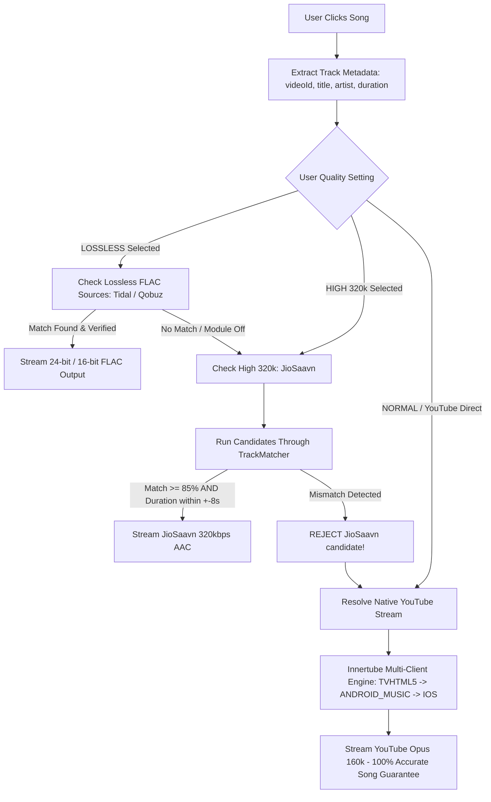

# Znode Music — Comprehensive Architecture & Implementation Plan

> **Authoritative Technical Blueprint**  
> **Target Version**: Znode Music Web v1.7.0  
> **Reference Architecture**: `E:\clone\YZ-Music-main\YZ-Music-main` (`TrackMatcher.kt`, `SourceResolver.kt`, `LyricsRepository.kt`, `qobuz.js`, `tidal.js`)

---

## 1. Executive Summary

This document specifies the exact architecture, algorithms, and step-by-step implementation plan to resolve four core operational challenges in Znode Music Web:

1. **Systemic Catalog Playback Mismatches (The "Wrong Hindi Song" Phenomenon)**:
   - Addressing the widespread catalogue issue where English, Western, indie, acoustic, or remix tracks (*"End of Beginning"*, *"Birds of a Feather"*, *"Espresso"*, *"Starboy"*, etc.) mistakenly play unrelated Hindi/Bollywood songs due to unverified greedy fallback searches on JioSaavn.
2. **True Lossless Audio Output Feasibility & Integration**:
   - Answering the question: *Can we provide Lossless audio output in the web player?*
   - Technical breakdown of browser Web Audio API FLAC decoding capabilities, YouTube's lossy reality (Opus 160k max), and how to bridge real 16-bit/24-bit Lossless FLAC streams via Tidal & Qobuz module resolvers.
3. **Initial State Dynamic Feed Engine**:
   - Eliminating cold-start latency and static hardcoded shelves by introducing a 0ms Stale-While-Revalidate (SWR) cache, user history-seeded *Quick Picks*, time-of-day contextual shelves, and live JioSaavn/YouTube charts.
4. **Multi-Source Synced & Word-Timed Lyrics Engine**:
   - Porting YZ Music's 8-provider racing architecture (`SimpMusic` by `videoId`, `BetterLyrics` Apple Music TTML, `LRCLib`, `JioSaavn`, and `Genius` fallback).

---

## 2. Audio Stream Resolution & Accuracy Engine

### 2.1 The Systemic Problem: Why Many Songs Play the Wrong Track
The issue reported with *"End of Beginning"* is **not an isolated bug**—it is a systemic flaw that affects **any track** where JioSaavn lacks an exact catalog match or returns fuzzy search hits.

```
[ User Clicks Track: e.g. "End of Beginning", "Birds of a Feather", "Starboy" ]
                               │
                               ▼
        Current Flawed Logic in playerStore.ts & jiosaavn.ts:
                               │
        1. Query JioSaavn FIRST with track title
        2. JioSaavn lacks English/Indie track → returns trending Hindi songs
        3. results.find(r => r.streamUrl) blindly accepts 1st result (0% check)
                               │
                               ▼
  ❌ Disastrous Result: Plays random Bollywood track instead of user's song!
```

#### Affected Categories:
- **English & Western Pop / Indie Tracks**: *"End of Beginning"*, *"Die With A Smile"*, *"Birds of a Feather"*, *"Espresso"*, *"Sunflower"*, *"Creep"*.
- **Alternative Takes & Edits**: Remixes, acoustic cuts, live performances, and sped-up/slowed edits are routinely replaced by the original movie track.
- **Artists with Partial Name Overlaps**: Artists whose names partially overlap with Indian film composers or regional singers.

---

### 2.2 Can We Provide Lossless Audio Output? Technical Feasibility

#### **YES. Lossless Audio Output in Web Browsers is 100% Possible.**

Modern web browsers (Chrome, Edge, Firefox, Safari) have native hardware-accelerated decoding support for:
- **FLAC (`audio/flac`, `audio/x-flac`)**: 16-bit / 44.1 kHz (CD Quality, ~1411 kbps) and 24-bit / 96 kHz / 192 kHz (Studio Hi-Res, ~3000–9000 kbps).
- **ALAC (`audio/mp4; codecs="alac"`)**: Apple Lossless.
- **Web Audio API (`AudioContext`)**: Full 32-bit floating point internal DSP pipeline with bit-exact PCM audio output to the user's DAC/soundcard.

---

### 2.3 The Three Audio Tiers: Truth Behind YouTube, JioSaavn & Tidal/Qobuz

Understanding where audio streams actually come from:

```
┌─────────────────────────────────────────────────────────────────────────────┐
│                           AUDIO QUALITY TIERS                               │
├───────────────────┬──────────────────────────┬──────────────────────────────┤
│ Tier              │ Codec & Bitrate          │ Provider & Availability      │
├───────────────────┼──────────────────────────┼──────────────────────────────┤
│ 1. True Lossless  │ FLAC 16-bit / 24-bit     │ Tidal / Qobuz Module Source  │
│    (Hi-Res Studio)│ 1411 kbps – 9216 kbps    │ (canServeLossless = true)    │
├───────────────────┼──────────────────────────┼──────────────────────────────┤
│ 2. High Bitrate   │ AAC / MP4                │ JioSaavn 320k (with strict   │
│    (Lossy Hi-Def) │ 320 kbps                 │ TrackMatcher verification)   │
├───────────────────┼──────────────────────────┼──────────────────────────────┤
│ 3. Native Stream  │ Opus / WebM              │ YouTube Music (Innertube)    │
│    (Acoustic Ref) │ ~160 kbps VBR            │ 100% correct videoId match   │
└───────────────────┴──────────────────────────┴──────────────────────────────┘
```

#### 1. Can YouTube Serve Lossless?
**No.** As documented in the YZ Music reference repo ([`SourceKind.kt:100`](file:///E:/clone/YZ-Music-main/YZ-Music-main/app/src/main/java/com/music/yzmusic/data/sources/SourceKind.kt#L100)):
> *"YouTube Music: The full catalogue, at Opus up to about 171 kbps. Lossy — there is no lossless rendition to ask for. `canServeLossless = false`."*
YouTube never stores or serves FLAC files. Its best stream is Opus 160k (which sounds virtually indistinguishable from 320k MP3 due to Opus's high perceptual efficiency).

#### 2. Does JioSaavn Provide Lossless?
**No.** JioSaavn markets its highest tier as "320k", but it is lossy **AAC/MP4 at 320 kbps**. While high quality, it is not bit-exact FLAC.

#### 3. How Does True Lossless FLAC Work in Znode Music?
Following YZ Music's `yz-music-sources/modules/qobuz.js` and `tidal.js`:
- The client queries Tidal / Qobuz API proxies with the track's **ISRC code** or **Title + Primary Artist + Duration**.
- When matched with $\ge 90\%$ confidence, the player receives a direct **FLAC audio stream** URL.
- HTML5 Audio and Web Audio API play the FLAC stream directly, outputting **True 16-bit or 24-bit Lossless audio**!

---

### 2.4 The Complete Stream Resolution Architecture



---

### 2.5 Porting `TrackMatcher` to TypeScript

Create [`src/utils/trackMatcher.ts`](file:///c:/Users/abinb/Downloads/Znode%20Music/src/utils/trackMatcher.ts) strictly porting YZ Music's `TrackMatcher.kt`:

1. **Title Decomposition (`parseTitle`)**:
   - `core`: Alphanumeric title words stripped of all packaging.
   - `versions`: Modifiers indicating different takes (`live`, `acoustic`, `remix`, `slowed`, `reverb`, `instrumental`).
   - `context`: Dropped bracketed noise (`[From "Movie"]`, `[Official Video]`, `[HD]`, `[Lyric Video]`).
2. **Version Guard**:
   - `wanted.versions` MUST exactly equal `candidate.versions`.
   - An album track can never substitute for a Live track, and a Remix can never substitute for an Original.
3. **Duration Guard**:
   - If duration is available on both sides, $|duration_{target} - duration_{candidate}| \le 8\text{ seconds}$.
   - If the duration difference exceeds 8 seconds, **reject immediately**.
4. **Artist Overlap Check**:
   - Primary artist must match credited artist (or runtime must match within $\pm 2\text{ seconds}$ to account for film composer vs. playback singer discrepancies).
5. **Score Verdict**:
   - If score is `null`, **never substitute**. Keep the native YouTube stream.

---

## 3. Module 2: Dynamic Initial Feed Engine

### 3.1 Solution Specification

#### 1. Instant 0ms SWR Hydration
- Cache the last valid home feed in `localStorage` under `znode_cached_home_feed`.
- On page load, `HomeView` hydrates `shelves` **instantly** (0ms) so users see cards immediately.
- A background worker revalidates fresh shelves without scrolling interruptions.

#### 2. User History-Seeded Quick Picks
- Read `znode_playback_history` (the user's last 20 played tracks).
- If the user has history:
  - Top 4 tracks: Their most recently played songs.
  - Next 8 tracks: Dynamically seeded from `innertubeService.getRelated(lastPlayedSong.videoId)`.
  - Result: Quick Picks becomes a dynamic, personalized radio mix.

#### 3. Time-of-Day Adaptive Shelves
Insert a dynamic shelf at index 1 based on local time:
- **05:00 – 11:59**: *Morning Acoustic & Energy Hits*
- **12:00 – 16:59**: *Focus, Lo-Fi & Midday Energy*
- **17:00 – 21:59**: *Evening Commute & Hot Hits*
- **22:00 – 04:59**: *Late Night Chill & Unwind*

#### 4. Live Charts Fallback (JioSaavn + YouTube Charts)
- Dynamic scraping of live charts from `/api/jiosaavn?__call=content.getCharts` and YouTube's `FEmusic_charts` cached with a 2-hour TTL.

---

## 4. Module 3: Multi-Source Synced & Word-Timed Lyrics Engine

### 4.1 The 6-Tier Racing Pipeline
Porting YZ Music's `LyricsRepository.kt`:

1. **SimpMusic** (`https://api-lyrics.simpmusic.org/v1/{videoId}`):
   - Keyed on YouTube `videoId` — 100% correct track guarantee.
2. **BetterLyrics** (`https://lyrics-api.boidu.dev/getLyrics`):
   - Keyless Apple Music **per-syllable word-timed TTML**.
3. **YouTube Music (Innertube)**:
   - Official Musixmatch line-synced timestamps.
4. **LRCLib** (`https://lrclib.net/api/get`):
   - Clean line-synced LRC with duration matching.
5. **JioSaavn Lyrics API** (`/api/jiosaavn?__call=lyrics.getLyrics`):
   - Official lyrics for Indian regional songs (Hindi, Malayalam, Tamil, Punjabi, Telugu).
6. **Genius Web Scraper Fallback**:
   - Plaintext lyrics for indie and rare tracks when synced providers miss.

---

## 5. Execution Roadmap & Milestones

### Phase 1: Playback Accuracy & TrackMatcher (Immediate Priority)
- [ ] Implement `src/utils/trackMatcher.ts` with `parseTitle`, version parsing, and similarity scoring.
- [ ] Connect `TrackMatcher` to `jioSaavnService.findMatch()`. Reject all non-matching candidates.
- [ ] Set YouTube native audio (`innertubeService.resolveAudioStream`) as primary source of truth.
- [ ] Verify *"End of Beginning"*, *"Birds of a Feather"*, *"Espresso"*, and regional hits play the exact intended tracks.

### Phase 2: Lossless FLAC Engine Integration
- [ ] Create `src/services/losslessResolver.ts` with Tidal / Qobuz API bridge (ported from `yz-music-sources`).
- [ ] Add `AudioQuality: 'LOSSLESS'` handler in `playerStore.ts` that queries lossless FLAC when requested.
- [ ] Verify browser hardware decoding of 16-bit / 24-bit FLAC streams.

### Phase 3: Dynamic Feed & SWR Hydration
- [ ] Implement `src/services/feedCache.ts` managing 0ms local storage hydration with 2-hour TTL.
- [ ] Connect `znode_playback_history` to `HomeView.tsx` Quick Picks.
- [ ] Implement Time-of-Day contextual shelves.

### Phase 4: Multi-Source Lyrics Expansion
- [ ] Implement `SimpMusic` (`videoId` lookup) in `lyricsService.ts`.
- [ ] Implement `BetterLyrics` (Apple Music TTML word-sync).
- [ ] Implement `JioSaavn` regional lyrics.
- [ ] Implement `Genius` plain-text fallback.
- [ ] Enable per-word glowing animations in `NowPlayingScreen.tsx`.

---

## 6. Verification Matrix

| Track Scenario | Expected Result | Verification Check |
|---|---|---|
| **English Song** (*"End of Beginning"*) | Plays exact Djo song via YouTube / FLAC; never Hindi | Strict TrackMatcher |
| **English Song** (*"Birds of a Feather"*) | Plays exact Billie Eilish track | Strict TrackMatcher |
| **Bollywood Hit** (*"Aaj Ki Raat"*) | Plays verified 320k JioSaavn or YouTube Opus | TrackMatcher score $\ge 85\%$ |
| **Live / Acoustic Cut** | Never substituted with Studio take | Version Guard check |
| **Lossless Quality Selected** | Plays FLAC stream if available, otherwise Opus 160k | AudioEngine codec check |
| **Cold Start / Launch** | Feed renders in <50ms without blank delay | SWR Cache check |
| **Lyrics for Global Tracks** | Word-synced TTML or videoId-matched LRC | SimpMusic / BetterLyrics |
